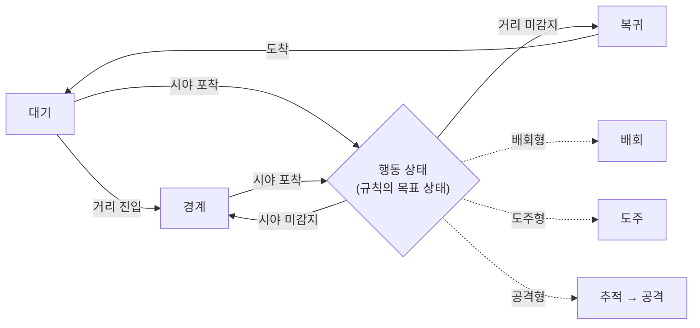
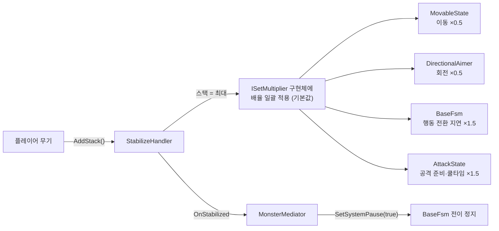

# Data-Driven Monster AI

외계 행성의 생물을 죽이지 않고 제압하는 2D 탑다운 게임(초기 기획)의 몬스터 AI로, 인스펙터에서 정의한 `조건 → 목표 상태` 규칙으로 행동이 바뀌는 모듈형 FSM입니다.

- **개발**: 5인 팀 (기획 2 · 프로그래밍 2 · 아트 1) / 프로그래머로 참여 · 팀 프로젝트 코드명 ProjectFS
- **기간**: 2026.03 ~ 2026.04
- **환경**: Unity 6 (URP), C#, UniTask, Odin Inspector
- 이 저장소는 팀 프로젝트 중 **본인이 담당한 몬스터 AI 코드**만 발췌했습니다.

## 핵심 문제 해결

### 1. 몬스터 행동 흐름: 종류가 늘 때마다 전이 코드를 새로 짜야 하는 문제

**문제**: 세 몬스터는 `대기 → 경계 → 행동 → 경계/복귀` 흐름이 같고 "행동" 칸만 다릅니다. 이 흐름을 상태 코드 안에 직접 쓰면 몬스터 종류가 늘 때마다 상태 코드를 복사해야 하고, 기획자가 흐름을 바꾸려면 프로그래머가 코드를 고쳐야 합니다.

**해결**: 각 행동 상태가 `조건 → 목표 상태` 규칙 리스트(`TransitionRule`)를 갖고, 매 프레임 위에서부터 평가해 처음 만족한 규칙 하나만 실행합니다. 리스트 순서가 곧 우선순위입니다. 조건은 판정만 하는 컴포넌트로 분리하고, 거리·시야 조건은 반전 플래그 하나로 진입/이탈과 포착/상실을 모두 표현해 같은 조건을 공격 시작과 재추적에 함께 씁니다. 규칙 제목은 `[공격 시작] AttackDistanceCondition(진입) → AttackState`처럼 자동으로 만들어 펼치지 않고도 흐름을 읽을 수 있고, 같은 문자열이 전이 로그의 사유로 찍힙니다.

**결과**: 배회형·도주형·공격형 3종이 같은 상태·조건 컴포넌트를 쓰고, 규칙의 목표 상태만 다르게 구성됐습니다. 새 몬스터는 규칙의 목표 상태를 바꿔 만들 수 있습니다.

관련 코드: [`BaseBahaviorState.cs`](02_States/BaseBahaviorState.cs) · [`BehaviorStateCondition.cs`](03_Conditions/BehaviorStateCondition.cs)

### 2. 무력화(안정화): 여러 컴포넌트를 느리게 하고 FSM을 멈추면서 서로 직접 참조하지 않게 하기

**문제**: 무력화되면 이동·회전·행동 전환·공격이 함께 느려지고 FSM 전이도 멈춰야 합니다. 안정화 핸들러가 이 컴포넌트들과 FSM을 직접 참조하면 서로를 알아야 해서 순환 참조가 생기고, 영향을 받는 대상이 늘 때마다 핸들러를 고쳐야 합니다.

**해결**: 무력화되면 몬스터 하위의 `ISetMultiplier` 구현체를 모두 찾아 타입별 배율을 한 번에 적용하고, 처리되지 않은 타입은 `NotImplementedException`으로 바로 드러나게 했습니다. `StabilizeHandler`는 FSM을 참조하지 않고 `MonsterMediator`에 이벤트만 알리며, 중재자가 FSM의 시스템 정지를 걸고 해제 시 대기 상태로 재시작합니다. 공격 관련 배율은 전투형 설정(`CombatStabilizeConfigSO`)에만 두어 비전투 몬스터 설정에 쓰지 않는 필드가 섞이지 않게 했습니다.

**결과**: 새 컴포넌트가 무력화 영향을 받으려면 `ISetMultiplier`만 구현하면 됩니다. 수면 이벤트도 같은 중재자 창구로 처리하도록 넣어 두어, FSM 코드를 고치지 않고 연결할 수 있습니다.

관련 코드: [`StabilizeHandler.cs`](04_Stabilize/StabilizeHandler.cs) · [`MonsterMediator.cs`](01_FSM/MonsterMediator.cs) · [`MonsterInterface.cs`](08_Data/MonsterInterface.cs)

## 구현 범위

- **모듈형 FSM과 데이터 기반 전이**: 상태를 컴포넌트로 붙이고, 인스펙터의 `조건 → 목표 상태` 규칙으로 행동 흐름을 정의
- **감지**: 시야(부채꼴 FOV)·거리 감지, 대상을 놓친 뒤 유예 시간이 지나면 경계 또는 스폰 지점으로 복귀
- **행동 상태**: 대기 · 경계 · 추적 · 도주 · 복귀 · 배회 · 공격
- **A\* 경로 탐색 연동**: 주기적 재계산, 실패 시 직선 이동, 배회 중 방향이 꺾인 각도만큼 감속
- **안정화(비살상 제압)**: 스택 누적·자연 감소, 무력화, 재무력화 면역
- **상태이상(속박·수면) 게이지**: 게이지 누적·자연 감소와 중재자 통지 (프리팹 연결 전 단계)
- **ScriptableObject 설정**과 **디버깅 지원**(상태 모니터링, 전이 로그, 시야·거리 기즈모, 디버그 씬)

## 코드 구성

| 폴더 | 설명 |
|---|---|
| `01_FSM` | `BaseFsm`이 상태 전이 · 전환 지연(UniTask) · 전이 차단/일시정지를 관리합니다. `MonsterMediator`는 FSM과 안정화 시스템을 Mediator 패턴으로 연결합니다. |
| `02_States` | `BaseBahaviorState`가 전이 규칙 리스트를 매 프레임 평가합니다. 공격·경계 상태와 `Move/`(추적·도주·복귀·배회)가 있습니다. |
| `03_Conditions` | 전이 조건입니다. `Distance/` 거리, `Sight/` 시야(기즈모 시각화 포함), `Time/` 시간 조건이 있고, AND 조건으로 묶을 수 있습니다. |
| `04_Stabilize` | `StabilizeHandler`: 스택 누적 및 자연 감소, 무력화, `ISetMultiplier`로 배율 일괄 적용, 무력화 후 일정 시간 재무력화 면역 |
| `05_PathFinding` | `PathfindingManager`는 월드 좌표와 그리드 좌표를 변환합니다. `ThirdParty_Ported/`는 오픈소스 A\*(Sebastian Lague / Ronen Ness) 포팅본입니다. |
| `06_Combat` | 공용 전투 컴포넌트: 체력(피격·무적·회복·사망 이벤트), 피격 부위, 데미지 트리거, 조준 회전, 스프라이트 반전 |
| `07_StatusEffect` | `StatusEffectHandler`: 속박·수면 게이지 증감, 속박 로프 풀링, 상태 진입/해제를 중재자에 통지 |
| `08_Data` | 이동 · 감지 · 공격 · 안정화 설정 ScriptableObject |
| `09_Debug` | 몬스터만 따로 테스트하는 디버깅 씬 |

## 기술 문서

내부 설계(FSM 구조, 전이 규칙, 조건 시스템, 안정화 흐름, 몬스터별 구성)는 [기술 문서](docs/TechnicalDesign.md)에 정리했습니다.
