# ProjectFS Monster AI — 기술 문서

[← README로 돌아가기](../README.md)

## 목차

1. [설계 목표](#1-설계-목표)
2. [전체 구조](#2-전체-구조)
3. [FSM 코어](#3-fsm-코어)
4. [데이터 기반 전이 규칙](#4-데이터-기반-전이-규칙)
5. [조건 시스템](#5-조건-시스템)
6. [행동 상태](#6-행동-상태)
7. [몬스터 3종 구성](#7-몬스터-3종-구성)
8. [안정화(비살상 제압) 시스템](#8-안정화비살상-제압-시스템)
9. [상태이상(속박·수면) 시스템](#9-상태이상속박수면-시스템)
10. [경로 탐색](#10-경로-탐색)
11. [ScriptableObject 설정](#11-scriptableobject-설정)
12. [디버깅 지원](#12-디버깅-지원)
13. [한계와 개선 방향](#13-한계와-개선-방향)

---

## 1. 설계 목표

| 목표 | 설계 방식 |
|---|---|
| 몬스터 종류가 늘어도 코드를 복사하지 않는다 | 상태·조건을 **컴포넌트**로 만들고, 몬스터는 컴포넌트 조합으로 구성 |
| 기획자가 행동 흐름을 직접 바꿀 수 있어야 한다 | 상태 전이를 코드가 아닌 **인스펙터의 규칙 리스트**로 정의 |
| 수치 조정에 프로그래머가 개입하지 않는다 | 감지 범위·타이밍·배율을 **ScriptableObject**로 분리 |
| 시스템 간 결합을 낮춘다 | FSM과 안정화·상태이상 시스템을 **Mediator**로 연결 |
| 업데이트 비용을 통제한다 | MonoBehaviour `Update` 대신 **UpdatePublisher** 옵저버 루프로 호출 |

---

## 2. 전체 구조

### 2.1 프리팹 계층

몬스터 프리팹은 역할별로 자식 오브젝트를 나눕니다. 상태와 조건은 모두 독립 컴포넌트입니다.

```
NormalMonster                  MonsterFsm · StabilizeHandler · MonsterMediator
├─ States                      IdleState · AlertState · WanderState · ReturnState
├─ Conditions                  DetectionDistanceCondition · LostSightTimeCondition · ...
└─ WeaponHolder                DirectionalAimer · DetectionSightCondition
```

- `WeaponHolder`는 `DirectionalAimer`가 회전시키는 피벗입니다. 시야 조건을 이 오브젝트에 두어, 시야 방향(`transform.right`)이 몬스터가 바라보는 방향을 그대로 따라갑니다.

> 📷 **[S01]** NormalMonster 프리팹 Hierarchy (States / Conditions / WeaponHolder 펼친 상태)
>
> 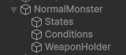

### 2.2 클래스 관계

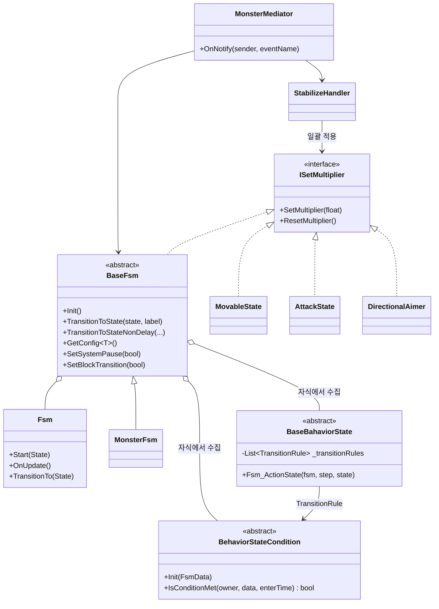

---

## 3. FSM 코어

### 3.1 `Fsm`: 델리게이트 기반 최소 FSM

상태를 클래스가 아닌 `delegate void State(Fsm fsm, Step step, State state)` 하나로 표현합니다. `Enter / Update / Exit`를 같은 함수 안에서 `step`으로 분기하므로, 상태 하나의 생명주기가 한 곳에 모입니다.

```csharp
public void TransitionTo(State state)
{
    _behaviorState?.Invoke(this, Step.Exit, state);
    var oldState = _behaviorState;
    _behaviorState = state;
    _behaviorState.Invoke(this, Step.Enter, oldState);
    _enterTime = 0;
}
```

### 3.2 `BaseFsm`: 두 계층의 상태

`BaseFsm`은 상태를 두 종류로 나눕니다.

| 구분 | 상태 | 역할 |
|---|---|---|
| 시스템 상태 | `Spawn`, `Idle`, `StatusEffect` | 생성 직후, 행동 재시작 지점 같은 공통 흐름. `BaseFsmStateType` enum으로 접근 |
| 행동 상태 | `BaseBahaviorState` 컴포넌트들 | 대기·경계·추적 등 실제 행동. 각 컴포넌트의 `Fsm_ActionState`를 `Fsm.State`로 등록 |

`MonsterFsm`은 시스템 `Idle`에 들어오면 인스펙터에서 지정한 시작 행동 상태로 넘어갑니다. 무력화가 끝난 뒤에도 같은 경로로 행동을 재시작합니다.

### 3.3 초기화 순서

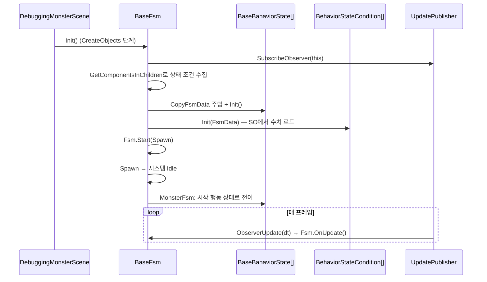

- 씬 라이프사이클(`AbstractScene`)의 `CreateObjects` 단계에서 `Init()`을 명시적으로 호출합니다. 그래서 `Awake/Start` 실행 순서에 의존하지 않습니다.
- 상태는 `Func<FsmData> CopyFsmData`로 FSM 정보(대상, 중재자, FSM 자신)를 **값 복사**로 받습니다. 상태 쪽에서 FSM 내부 필드를 직접 바꿀 수 없습니다.

### 3.4 전이 API와 가드

| API | 용도 | 지연 | 가드 |
|---|---|---|---|
| `TransitionToState(state, label)` | 일반 행동 전이 (규칙 평가 결과) | `ActionTransitionTime × 반응 배율` | 시스템 정지, 전이 차단, 이미 대기 중, 같은 상태 |
| `TransitionToStateNonDelay(state)` | 즉시 전이 | 없음 | 시스템 정지, 전이 차단 |
| `TransitionToStateNonDelay(BaseFsmStateType)` | 시스템 상태로 복귀 | 없음 | 시스템 정지, 전이 차단 |

지연 전이는 UniTask로 구현했습니다.

```csharp
ActiveState?.ForceStateExit();                 // 기존 행동 즉시 중단
float delay = movConfig.ActionTransitionTime * _transitionDelayMultiplier;

_transitionCts?.Cancel();
_transitionCts = new CancellationTokenSource();
await UniTask.Delay(TimeSpan.FromSeconds(delay), cancellationToken: _transitionCts.Token);

_currentStateName = baseState.GetType().Name;  // 인스펙터 모니터링
ActiveState = baseState;
_fsm.TransitionTo(baseState.Fsm_ActionState);
```

- **반응 지연**: 판단 후 바로 행동하지 않고 "멈칫"하는 시간을 둡니다. 안정화 중에는 이 시간에 배율이 곱해져 반응이 느려집니다.
- **중복 방지**: `_isWaitingTransition` 플래그로 대기 중 다른 전이 요청을 무시합니다.
- **두 종류의 차단 플래그**
  - `_blockTransition`: 행동 자신이 거는 잠금 (예: 공격 쿨타임 중 전이 금지)
  - `_isSystemPaused`: 외부 시스템(안정화·수면)이 거는 정지

---

## 4. 데이터 기반 전이 규칙

### 4.1 `TransitionRule`

모든 행동 상태는 `조건 → 목표 상태` 규칙 리스트를 가집니다.

```csharp
[Serializable]
public struct TransitionRule
{
    [LabelText("규칙 용도")] public string UsageTag;
    [Required] public BehaviorStateCondition Condition;
    [Required] public BaseBahaviorState TargetState;
}
```

매 프레임 리스트를 위에서부터 평가하고, **처음으로 만족한 규칙 하나만** 실행합니다. 따라서 **리스트 순서가 곧 우선순위**입니다.

```csharp
foreach (var rule in _transitionRules)
{
    if (rule.Condition &&
        rule.Condition.IsConditionMet(transform, CopyFsmData(), _stateEnterTime))
    {
        CopyFsmData().BaseFsm.TransitionToState(rule.TargetState, rule.GetRuleLabel()).Forget();
        return;
    }
}
```

### 4.2 인스펙터 가독성

Odin `ListDrawerSettings(ListElementLabelName = "@GetRuleLabel()")`로 각 규칙의 제목을 실시간 생성합니다.

```
[행동 전환] DetectionSightCondition(포착) → ChaseState
[공격 시작] AttackDistanceCondition(진입) → AttackState
[거리 미감지] LostDistanceTimeCondition(미감지 유예(5s)) → ReturnState
```

조건 클래스가 `GetConditionExtraInfo()`로 모드나 수치를 덧붙이므로, 규칙을 펼치지 않고도 흐름을 읽을 수 있습니다. 같은 문자열이 전이 로그의 사유로도 출력됩니다.

> 📷 **[S02]** AttackMonster의 ChaseState 인스펙터 — Transition Rules 3개(시야 미감지 / 거리 미감지 / 공격 시작)가 보이는 상태
>
> 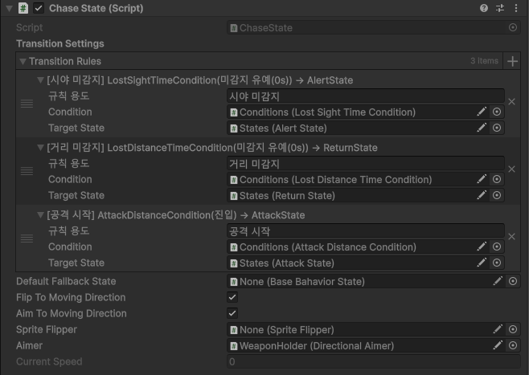

---

## 5. 조건 시스템

### 5.1 계약

```csharp
public abstract class BehaviorStateCondition : MonoBehaviour
{
    public abstract void Init(FsmData fsmData);   // SO에서 수치 로드
    public abstract bool IsConditionMet(Transform owner, FsmData fsmData, float stateEnterTime);
    public virtual string GetConditionExtraInfo() => "";
}
```

조건은 상태를 바꾸지 않고 **판정만** 합니다. 판정에 필요한 시간 정보는 상태가 넘겨주는 `stateEnterTime`(현재 상태 진입 후 경과 시간)을 씁니다.

### 5.2 계층

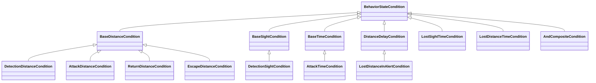

| 조건 | 판정 | 수치 출처 |
|---|---|---|
| `DetectionDistanceCondition` | 대상이 감지 반경 안/밖 | `DetectionConfigSO.DistanceRadius` |
| `AttackDistanceCondition` | 대상이 공격 범위 안/밖 | `AttackConfigSO.AttackRange` |
| `ReturnDistanceCondition` | 스폰 지점 도달 반경 | `DetectionConfigSO.ReturnArrivalRadius` |
| `EscapeDistanceCondition` | 도주 종료 거리 | `EscapeDetectionConfigSO.EscapeEndDistance` |
| `DetectionSightCondition` | 부채꼴 시야(반경 + 각도) 안에 대상 | `DetectionConfigSO.ViewRadius / ViewAngle` |
| `LostSightTimeCondition` | 시야는 잃었지만 거리 안에 있는 상태가 N초 지속 | `DetectionConfigSO.ActionHoldTime` |
| `LostDistanceTimeCondition` | 거리 밖 상태가 N초 지속 | `DetectionConfigSO.LostTargetReturnTime` |
| `LostDistanceInAlertCondition` | 경계 유지 시간마다 거리 이탈 여부 확인 | `DetectionConfigSO.AlertHoldTime` |
| `AttackTimeCondition` | 상태 진입 후 N초 경과 | `AttackConfigSO.CancelTime` |
| `AndCompositeCondition` | 하위 조건 전부 만족 | — |

### 5.3 재사용을 위한 설계 포인트

**1) 반전 플래그로 클래스 수 줄이기**

거리 조건은 `_exitIfNear`, 시야 조건은 `_exitIfLost` 플래그 하나로 "진입/이탈", "포착/상실"을 모두 표현합니다. 예를 들어 AttackMonster는 같은 `AttackDistanceCondition`을 두 개 붙여 하나는 `공격 시작`(진입), 하나는 `재추적`(이탈)에 씁니다.

**2) 조건이 조건을 참조하는 합성**

`LostSightTimeCondition`은 직접 거리를 계산하지 않고 시야 조건과 거리 조건 컴포넌트를 참조해 결과를 조합합니다.

```csharp
bool hasSight = _sightCondition.IsConditionMet(owner, fsmData, stateEnterTime);
bool inRange  = _distanceCondition.IsConditionMet(owner, fsmData, stateEnterTime);

if (fsmData.Mediator.IsStabilized || hasSight || !inRange)
{
    _lostTimer = 0f;           // 시야 회복·거리 이탈·무력화 시 카운트 초기화
    return false;
}

_lostTimer += Time.deltaTime;
return _lostTimer >= _lostCountDuration;
```

감지 수치를 바꾸면 이를 참조하는 모든 복합 조건에 자동으로 반영됩니다.

**3) 설정 로드 공통화**

거리 조건 하위 클래스는 어떤 SO의 어떤 값을 쓸지만 선언합니다.

```csharp
public class AttackDistanceCondition : BaseDistanceCondition
{
    public override void Init(FsmData fsmData)
        => SetupConfig<AttackConfigSO>(fsmData, config => config.AttackRange);
}
```

### 5.4 시각화

거리 조건은 원(진입 = 빨강 / 이탈 = 파랑), 시야 조건은 부채꼴과 `시야 75° / 10m` 라벨을 Scene 뷰에 그립니다.

> 📷 **[S03]** Scene 뷰 — 몬스터 선택 시 시야 부채꼴 + 거리 원 기즈모 (라벨 보이게)
>
> 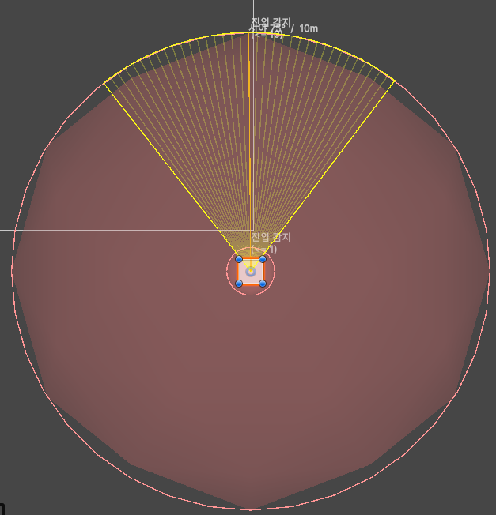

---

## 6. 행동 상태

| 상태 | 동작 |
|---|---|
| `IdleState` | 동작 없음. 전이 규칙만 평가 |
| `AlertState` | 대상 방향으로 경계 회전 속도(`AlertRotationSpeed`)로 조준 |
| `ChaseState` | 대상 위치까지 A\* 경로 이동 |
| `EscapeState` | 대상 반대 방향 5m 지점까지 경로 이동 |
| `ReturnState` | 초기화 시점 위치(스폰 지점)로 복귀 |
| `WanderState` | 진입 위치 기준 반경 안 랜덤 지점을 순회, 도착 후 랜덤 대기 |
| `AttackState` | 준비 시간 → 범위 판정 후 피해 → 쿨타임 반복 |
| `EventState` | Enter/Update/Exit마다 UnityEvent 호출 (연출용) |

### 6.1 `MovableState`: 이동 공통 로직

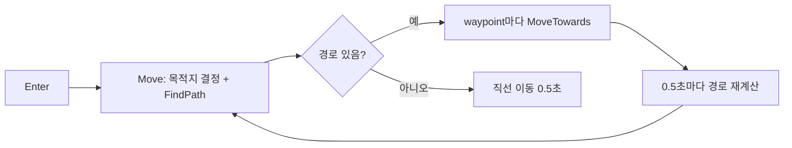

- 이동은 `async UniTaskVoid` 루프로 처리하고, 상태를 나가면 `CancellationToken`으로 즉시 중단합니다.
- 대상이 있으면 0.5초마다 경로를 다시 계산해 움직이는 대상을 따라갑니다.
- 경로 탐색에 실패하면 목표 방향으로 0.5초 직선 이동해 제자리에 멈추지 않게 합니다.
- 하위 상태는 `Move()`에서 **목적지만** 정합니다.

```csharp
public class ChaseState : MovableState
{
    public override void Move()
    {
        _direction = (CopyFsmData().Target.position - transform.position).normalized;
        _currentPath = Pathfinding.FindPath(_pathGrid,
            GetGridPoint(transform.position), GetGridPoint(CopyFsmData().Target.position));
        StartMoving();
    }
}
```

### 6.2 배회 중 방향 전환 감속

`MovableState`는 이동 방향을 받아 속도를 돌려주는 훅을 엽니다. 기본 구현은 원래 속도를 그대로 반환합니다.

```csharp
protected virtual float GetMoveSpeed(Vector3 moveDir) => CurrentSpeed;
```

`WanderState`는 이 훅을 재정의해, 방향이 꺾인 각도에 비례해 감속한 뒤 Lerp로 원래 속도까지 복귀합니다.

```csharp
protected override float GetMoveSpeed(Vector3 moveDir)
{
    if (_lastMoveDir != Vector3.zero && moveDir != Vector3.zero)
    {
        float angle = Vector3.Angle(_lastMoveDir, moveDir);
        float targetRatio = Mathf.Lerp(1f, _turnMinSpeedRatio, angle / 180f);
        _turnSpeedRatio = Mathf.Min(_turnSpeedRatio, targetRatio);
    }
    _lastMoveDir = moveDir;

    _turnSpeedRatio = Mathf.Lerp(_turnSpeedRatio, 1f, _turnRecoverSpeed * Time.deltaTime);
    return base.GetMoveSpeed(moveDir) * _turnSpeedRatio;
}
```

| 꺾인 각도 | 속도 비율 (`_turnMinSpeedRatio = 0.3`) |
|---|---|
| 45° (A\* 대각 꺾임) | 약 0.82 |
| 90° | 0.65 |
| 180° | 0.30 |

- 추적·도주는 반응성이 중요하므로 감속을 적용하지 않고, 배회에만 적용했습니다.
- 배회 상태에 들어올 때 이전 방향 기록을 초기화해, 다른 상태에서 넘어온 직후 엉뚱한 감속이 생기지 않게 했습니다.

> 📷 **[S04]** WanderState 인스펙터 — Wander Settings + Turn Slowdown Settings
>
> 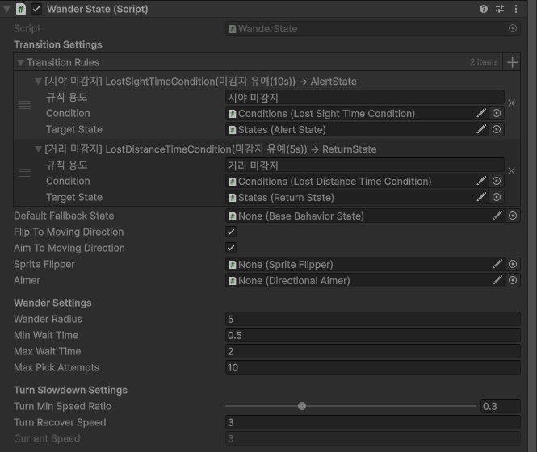

### 6.3 `AttackState`: 공격 루프

```csharp
while (!token.IsCancellationRequested)
{
    await UniTask.Delay(TimeSpan.FromSeconds(_currentAttackPrepTime), cancellationToken: token);
    if (CopyFsmData().Mediator.IsStabilized) { return; }

    ExecuteAttackQuery();                       // 범위 안일 때만 피해

    CopyFsmData().BaseFsm.SetBlockTransition(true);
    await UniTask.Delay(TimeSpan.FromSeconds(_currentAttackCooltime), cancellationToken: token);
    CopyFsmData().BaseFsm.SetBlockTransition(false);
}
```

- **준비 시간(Prep)**: 공격 전 예비 동작 시간을 두어 플레이어가 피할 수 있게 했습니다. 피해는 준비가 끝난 시점에 범위 안에 있을 때만 들어갑니다.
- **쿨타임 중 전이 차단**: 공격 직후 바로 추적으로 튀는 어색한 움직임을 막습니다.
- **배율**: 준비·쿨타임은 상태 진입 시 배율을 곱해 계산하므로, 안정화 중에는 공격이 느려집니다.

---

## 7. 몬스터 3종 구성

세 몬스터는 **같은 상태·조건 컴포넌트**를 쓰고, 규칙의 목표 상태만 다릅니다. 아래 다이어그램은 실제 프리팹의 규칙을 그대로 옮긴 것입니다.

### 7.1 배회형 (NormalMonster)

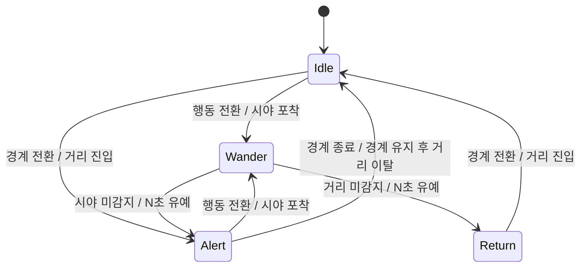

### 7.2 도주형 (EscapeMonster)

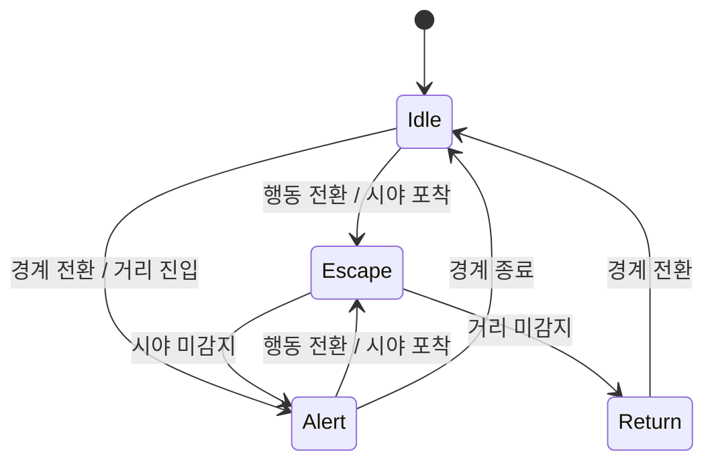

### 7.3 공격형 (AttackMonster)

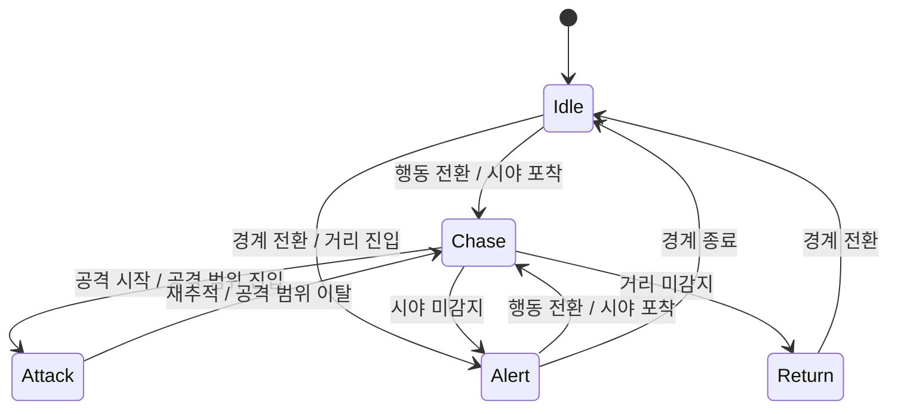

공통 흐름은 `대기 → (거리 감지) 경계 → (시야 포착) 행동 → (놓침) 경계/복귀`입니다. 종류별 차이는 "행동" 칸에 무엇을 넣느냐뿐이라, 새 몬스터는 규칙의 목표 상태만 바꿔 만들 수 있습니다.

> 📷 **[S05]** DebuggingMonsterScene Game 뷰 — 세 종류 몬스터와 플레이어가 함께 보이는 화면
>
> 

---

## 8. 안정화(비살상 제압) 시스템

### 8.1 흐름

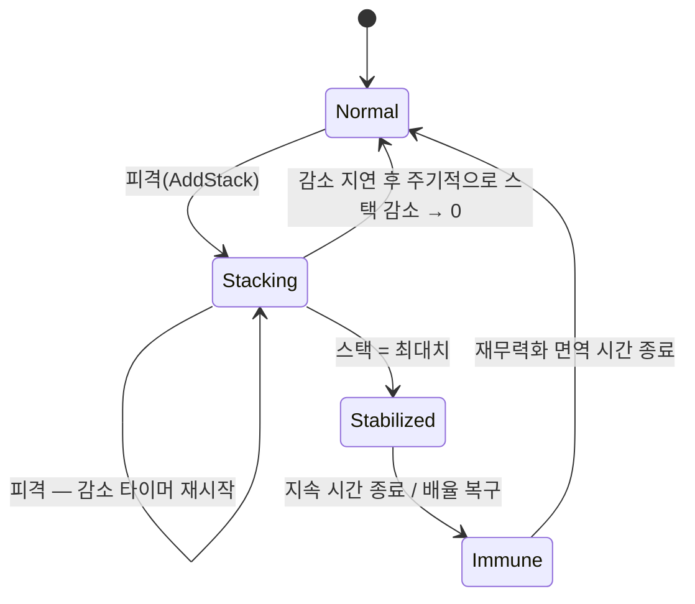

| 단계 | 처리 | 설정값 |
|---|---|---|
| 누적 | 피격마다 스택 +1, 진행 중인 감소 타이머 취소 | `MaxStabilizeStack` |
| 자연 감소 | 마지막 피격 후 지연 → 주기마다 일정량 감소 | `StackDecayDelay / Interval / Amount` |
| 무력화 | 중재자에 통지, 배율 일괄 적용 | `StabilizeDuration` |
| 면역 | 해제 직후 일정 시간 스택 무시 (연속 무력화 방지) | `RestabilizeImmunityTime` |

세 단계 모두 독립된 `CancellationTokenSource`를 가진 UniTask로 구현했고, `OnDestroy`에서 일괄 취소합니다.

### 8.2 `ISetMultiplier`: 배율 일괄 적용

무력화가 걸리면 몬스터 하위의 `ISetMultiplier` 구현체를 모두 찾아, 타입별 배율을 적용합니다.

```csharp
foreach (ISetMultiplier multiplier in _multipliers)
{
    float targetMultiplier = multiplier switch
    {
        AttackState      => combatConfig != null ? combatConfig.StabilizeAttackPrepMultiplier : 1f,
        MovableState     => _config.StabilizeMoveMultiplier,
        DirectionalAimer => _config.StabilizeRotationMultiplier,
        BaseFsm          => _config.StabilizeReactionMultiplier,
        _ => throw new NotImplementedException()
    };
    multiplier.SetMultiplier(targetMultiplier);
}
```

| 대상 | 영향 | 기본값 |
|---|---|---|
| `MovableState` | 이동 속도 | ×0.5 |
| `DirectionalAimer` | 회전 속도 | ×0.5 |
| `BaseFsm` | 행동 전환 지연 | ×1.5 |
| `AttackState` | 공격 준비·쿨타임 (전투형 설정일 때만) | ×1.5 |

- 새 컴포넌트가 무력화 영향을 받아야 하면 `ISetMultiplier`만 구현하면 됩니다. 처리되지 않은 타입은 `NotImplementedException`으로 즉시 드러나게 했습니다.
- 공격 관련 배율은 `CombatStabilizeConfigSO`에만 있습니다. 비전투 몬스터 설정에 쓰이지 않는 필드가 섞이지 않게 상속으로 분리했습니다.

### 8.3 Mediator로 FSM과 연결

`StabilizeHandler`는 FSM을 직접 참조하지 않고 중재자에 이벤트만 알립니다.

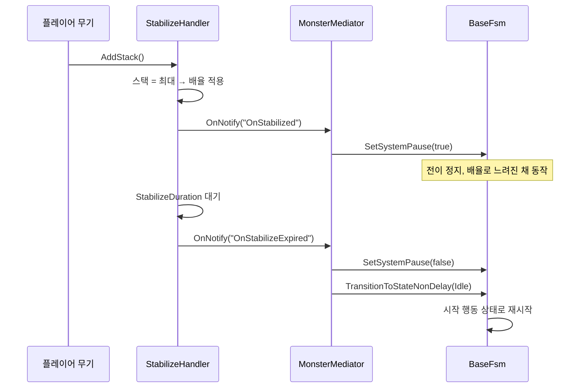

- 중재자는 `Awake`에서 자신을 FSM과 안정화 핸들러에 등록합니다. 두 컴포넌트가 서로를 몰라도 되므로 순환 참조가 생기지 않습니다.
- 수면도 같은 이벤트 창구(`OnSleepEntered / OnSleepExited`)로 FSM을 정지·재개하도록 중재자에 처리를 넣어 두었습니다. 새 시스템은 중재자에 이벤트만 추가하면 FSM 코드를 건드리지 않고 연결됩니다.
- 조건과 공격 루프는 `FsmData.Mediator.IsStabilized`를 확인해, 무력화 중에는 타이머를 초기화하거나 공격을 취소합니다.

> 📷 **[S06]** 플레이 중 StabilizeHandler 인스펙터 — 스택 수치와 `IsStabilized = true`인 순간
>
> 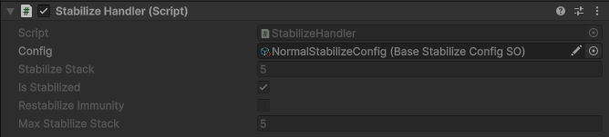

---

## 9. 상태이상(속박·수면) 시스템

> 현재 단계: 로직 구현 완료, 몬스터 프리팹 연결 전

`StatusEffectHandler`는 속박과 수면을 **게이지** 하나씩으로 통합 관리합니다.

| 효과 | 증가 | 감소 | 발동 |
|---|---|---|---|
| 속박 | 속박 무기 명중 시 `ApplyBindHit` | 매 프레임. 이동·공격 중이면 더 빠르게 감소 (기본 초당 10 → 20) | 게이지 최대 → `OnBindEntered` |
| 수면 | 수면 안개 안에 있는 동안 매 프레임 | 안개 밖에서 매 프레임 | 게이지 최대 → `OnSleepEntered` |

- **행동에 따른 감소 속도**: `_fsm.ActiveState is AttackState or MovableState`로 판단합니다. FSM 내부 상태를 직접 읽지 않고 현재 활성 상태의 타입만 봅니다.
- **속박 로프 시각화**: 게이지를 `BindRopeUnit`으로 나눈 개수만큼 로프를 표시합니다. 로프는 리스트 풀로 재사용해 Instantiate/Destroy를 반복하지 않습니다.
- **예외 규칙**: 수면 중에는 속박이 걸리지 않습니다.
- **업데이트**: `UpdatePublisher` 옵저버로 게이지를 갱신합니다.

---

## 10. 경로 탐색

- `PathfindingManager`가 그리드(크기·원점·셀 크기)를 생성하고 월드 ↔ 그리드 좌표를 변환합니다.
  - `WorldToGrid`: 그리드 범위로 Clamp해 맵 밖 좌표도 안전하게 처리
  - `GridToWorld`: 셀 중심으로 보정
- A\* 본체(`ThirdParty_Ported/`)는 오픈소스(Sebastian Lague / Ronen Ness)를 프로젝트 구조에 맞게 옮긴 것입니다. 본인 작업 범위는 이동 상태와의 연동(주기적 재계산, 실패 시 대체 이동)입니다.

---

## 11. ScriptableObject 설정

### 11.1 설정 조회

`BaseFsm`은 여러 종류의 SO를 하나의 배열로 받고, 필요한 쪽에서 타입으로 꺼냅니다.

```csharp
[SerializeField] private ScriptableObject[] _stateConfigs;

public T GetConfig<T>() where T : ScriptableObject
{
    foreach (ScriptableObject config in _stateConfigs)
    {
        if (config is T target) { return target; }
    }
    return null;
}
```

- 상태·조건은 `Init()`에서 한 번만 조회해 필드에 캐싱하고, 매 프레임에는 조회하지 않습니다.
- 몬스터마다 다른 SO 조합을 넣으면 같은 컴포넌트로 다른 수치를 씁니다.
- `EscapeDetectionConfigSO : DetectionConfigSO`처럼 상속한 SO를 넣으면, 기본 감지 조건도 그대로 동작합니다.

### 11.2 설정 목록

| SO | 주요 값 |
|---|---|
| `MovementConfigSO` | 이동 속도, 회전 속도, 경계 회전 속도, 행동 전환 시간 |
| `DetectionConfigSO` | 거리/시야 반경, 시야 각도, 경계 유지 시간, 미감지 판정 시간, 복귀 도달 반경 |
| `EscapeDetectionConfigSO` | 위 항목 + 도주 종료 거리 |
| `AttackConfigSO` | 공격 범위, 준비 시간, 쿨타임, 이탈 후 경직, 데미지 |
| `BaseStabilizeConfigSO` | 최대 스택, 감소 지연/주기/양, 무력화 시간, 면역 시간, 배율 |
| `CombatStabilizeConfigSO` | 위 항목 + 공격 준비 배율 |

Odin의 `TabGroup`, `LabelText`로 기획자가 읽기 쉬운 한글 라벨과 탭 구분을 붙였습니다.

> 📷 **[S07]** MonsterFsm 인스펙터 — State Configs 배열에 SO들이 연결된 모습
>
> 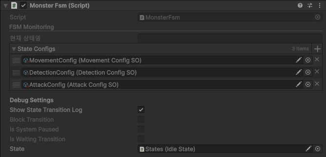
>
> 📷 **[S08]** DetectionConfigSO 인스펙터 — 감지 / 상태 탭
>
> 

---

## 12. 디버깅 지원

| 도구 | 내용 |
|---|---|
| 상태 모니터링 | `MonsterFsm` 인스펙터에 현재 상태명, 전이 차단·정지·대기 플래그를 실시간 표시. 플레이 중 인스펙터를 강제로 다시 그림 |
| 전이 로그 | `[FSM Transition]` 사유(규칙 라벨), `[FSM Delay]` 대기 시간 출력. 몬스터별로 끌 수 있음 |
| 기즈모 | 시야 부채꼴, 거리 원, 모드 라벨 |
| 컨텍스트 메뉴 | `StabilizeHandler`의 `AddStack`을 인스펙터 메뉴로 직접 호출 |
| 전용 씬 | `DebuggingMonsterScene`: 플레이어·투사체 풀·수면 영역 관리자·몬스터만 초기화해 AI만 따로 검증. 사운드는 `NullSoundService`로 대체 |

> 📷 **[S09]** 플레이 중 MonsterFsm 인스펙터 — FSM Monitoring의 현재 상태명이 표시된 모습
>
> 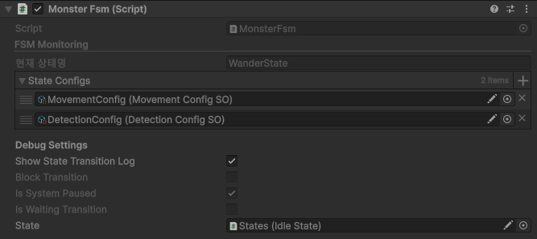
>
> 📷 **[S10]** Console — `[FSM Transition]` / `[FSM Delay]` 로그가 연속으로 찍힌 모습
>
> 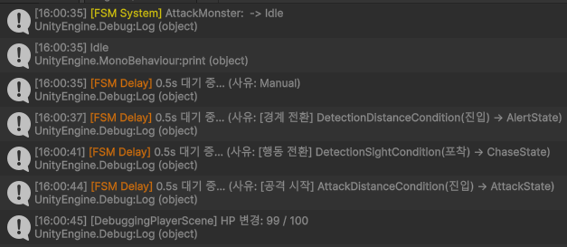

---

## 13. 한계와 개선 방향

| 항목 | 현재 | 개선 방향 |
|---|---|---|
| 시야 차폐 | 반경·각도만 판정 (`_obstacleMask`는 선언만 됨) | Raycast로 벽 뒤 대상 제외 |
| 경로 그리드 | 모든 칸을 통과 가능으로 초기화 | 타일맵·콜라이더 기반으로 walkable 베이크 |
| 복귀 상태 | `TransitionToState`가 `ReturnState`로의 전이를 막고 있음 | 복귀 도착 처리와 함께 활성화 |
| 중재자 이벤트 | 문자열 이벤트명 (`"OnStabilized"`) | enum 또는 타입 기반 이벤트로 오타 방지 |
| 상태이상 | 로직만 완성, 프리팹 미연결, 속박 이벤트는 중재자에서 미처리 | 프리팹 연결, 속박 시 이동 제한 처리 |
